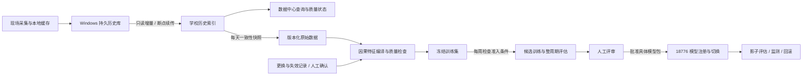

# Booth2 持续采集与候选训练

2026-11-20。用户确认：**自动采集、自动训练和评估候选，人工确认发布**。开发在学校 `ANN-Server`；公司现场机由现场人员安装交接。本文将 RSI 理解为有监督的持续改进，不是模型自动修改目标、自动把自己的预测当标签或自动替换线上模型。

## 已实现与尚待接通

| 层 | 当前交付 | 实际边界 |
| --- | --- | --- |
| 源端持久化 | 沿用 Linux 本地采集库 → Windows 历史库 → 8780 只读 API | 源端已部署情况见 11-19 现场核查；本轮未操作公司机器 |
| 学校增量镜像 | `domain/history_sync.py`、`history_index.py`；新增 `scripts/learning_cycle.py collect` 无界面进程 | 本轮以模拟 API 验证，学校到现场的历史 API 地址、只读密钥及网络尚未配置和验收 |
| 一致性快照 | `learning_cycle.py snapshot`：SQLite backup、完整性检查、SHA-256、游标与范围清单 | 是原始历史快照，明确 `training_ready=false`，不是自动可训练数据 |
| 数据准入 | `assess` 检查确认标签、周期成熟度、特征一致性与质量审核、实际文件哈希 | 新增现场原始通知 → 因果特征的编译器仍需开发、与历史计算逐点核验 |
| 候选任务 | `train-once`：进程锁、版本化输入、无 shell 的固定 argv、限时、日志、输出哈希、失败去重 | 需一份本地审核的训练配方；结束状态为 `awaiting_evaluation_review`，无发布入口 |
| 定时执行 | `deploy/continuous-learning/` 的 systemd 用户服务与 timer 模板 | 模板尚未安装或启用；缺少数据集时明确等待，不伪造训练成功 |
| 模型研究 | v5 的 6 种删失感知方法、14 折整周期留出、3 个前向时间块 | 老历史已被反复研究，不能叫新增盲测；结果见 `model-v5-evaluation.md` |

## 数据中心结构



建议保留四层目录，原始大文件不进 Git：

```text
/home/dev/Zhang/private/continuous_learning/
  index/history/plasma2.sqlite3     # 实时追加镜像与索引
  snapshots/history-<sha256>/      # 完整 SQLite 快照 + manifest
  datasets/<dataset-id>/           # 只读特征、标签、划分、审核证据
  jobs/<job-id>/                   # 配方、输入清单、日志、模型与评估
  current/dataset.json             # 调度入口，原子更新
```

现阶段使用 SQLite WAL + Parquet 足够；训练用 Parquet，趋势用索引与分钟/小时桶。不要为了模型训练立刻迁移整个历史库。数据量、并发或多设备数增长到单库难以满足需求时，再评估 PostgreSQL/TimescaleDB 与对象存储。数据中心应展示数据源、已索引时间、源端/本地水位、最后成功、质量问题、标签待审数、数据集版本、训练状态和候选评估；将实时值、历史入库和模型状态分别表达。

源端每批事务立即落盘，不能等夜间任务才保存实时值。学校断网时，源端继续积累；连接恢复按 ID 补拉。学校网页关闭不影响采集。索引中 `(source_id, source_epoch, source_seq)` 去重；原始值冲突或源 ID 回退需要处理，不应悄悄改写旧记录。只读镜像不能替代公司源库备份。

快照使用 SQLite backup API，避免直接复制正在写入的 `.sqlite3` 而漏掉 WAL。每日全量快照是初期实现；部署前按每天真实增长量制定容量与保留策略，后续用分区 Parquet、增量清单和定期全量校验降低成本。当前工具不会自动删除任何快照。快照应额外复制到第二存储并定期恢复验证；本轮未配置异地备份。

## 新数据什么时候能用于寿命训练

一个实时采样值不是一个新失效样本。独立信息量主要来自电极/喷枪完整使用周期，而不是一秒一行的总行数。每个周期至少记录：

| 内容 | 必须保存 |
| --- | --- |
| 设备与周期 | equipment、gun/electrode ID、安装/更换边界、cycle_id、来源证据 |
| 时间 | UTC 时间、源时区、接收时间、累计**加工小时**；加工小时不是墙钟剩余时间 |
| 结局 | EOL、预防性更换/观察终止（右删失）、其他故障/未知原因 |
| 审核 | 标签版本、记录者、确认者、确认时间、证据文件哈希、修改理由 |
| 数据质量 | 缺测/坏质量、单位和倍率、时钟异常、重连、关键字段覆盖率 |

失败原因未明确时暂缓入集；不要把因送料/压力问题停机全部标成电极寿终。更换前没有失效的周期按右删失处理，不能把更换时刻当真实寿终。历史 v1/v2 EOL 定义相差约 2.5 分钟，必须保留标签版本。旧原始日志的时区尚未确认，不能直接与现场 UTC 拼接。

通知长表需做因果 as-of 对齐：只用预测时刻之前已接收的读数，保留质量、持有时长和观测掩码；不得用未来值插值。采集变化通知的“无新值”不等于缺测；按点位有效期和整体采集心跳判断。产品结束后才可知的 eligibility、最终合格结果等不能反向成为在线输入。新特征编译器必须重放历史，检查输入、加工累计时长、窗口统计与既有模型实现的一致性。

## 训练和评估节奏

初始建议是每 5 秒同步一批历史、每日归档、每周检查训练条件。`train-once` 默认至少新增 **3 个已确认的闭合周期，其中至少 2 个 EOL** 才启动候选；这是成本和信息量的工程门槛，不是统计充分性的保证。纠正旧标签或重跑失败实验需要新配方版本/人工启动研究任务，不能每周因相同失败无限重试。

按整周期划分训练/验证/测试，重叠窗口不得跨折。参数、标准化、阈值、区间校准和早停全部只看训练/内层验证。新数据先进入冻结的未来评估集；明确解冻后才加入下一轮训练，保存其首次未见评估。标签确认时间不能晚于数据集构建时间；真实前向回测还需按**当时可用**的标签时间重建训练集。

每轮至少比较当前模型、简单基线、删失 AFT/树和小神经网络，输出逐周期误差、末 1/2 小时误差与高估偏差、分位覆盖和宽度、1/4/8 小时 Brier、提前 ≥20 分钟命中、迟报、每 100 加工小时误报及不可判定报警。以整周期 bootstrap/前向区块看不确定性，不能把 81,235 个高度相关原点当 81,235 个独立样本。IPCW 依赖删失机制假设，截断权重必须记录；当前 10 次寿终不足以承诺分布无关区间覆盖。

发布评审应在看到新测试结果前固定指标与允许退步幅度；与当前包在**同一冻结集、同一风险定义、同一报警预算**下比较。还需检查导出/运行时一致性、因果性、缺测/停机降级、推理延迟和页面切换。当前先保留研究包，不因某个均值变好就替换线上。未来生产阈值由实际漏报/误报成本确定。

## 运行命令与数据契约

以下命令在候选仓库根目录执行。密钥只存权限受限文件；采集进程通过 `PHASE2_HISTORY_API_KEY_FILE` 读取，不能放进训练集、日志或前端。

```bash
python scripts/learning_cycle.py collect --index-root /path/to/index
python scripts/learning_cycle.py snapshot --database /path/to/index/history/plasma2.sqlite3 --destination /path/to/snapshots
python scripts/learning_cycle.py assess --manifest /path/to/dataset/dataset.json
python scripts/learning_cycle.py train-once --manifest /path/to/dataset/dataset.json --recipe /path/to/reviewed-recipe.json --state-root /path/to/state
```

`dataset.json` 最低契约：

```json
{
  "schema_version": 1,
  "dataset_id": "booth2-<content-hash>",
  "snapshot_id": "history-<sha256>",
  "status": "ready",
  "created_at": "2026-11-20T00:00:00+00:00",
  "feature_version": "causal-live-v1",
  "label_version": "eol-reviewed-v1",
  "feature_equivalence_review": {"passed": true, "reviewer": "reviewer-id", "artifact": "equivalence.json"},
  "quality_review": {"passed": true, "reviewer": "reviewer-id", "artifact": "quality.json"},
  "artifacts": {"frame.parquet": "<sha256>", "equivalence.json": "<sha256>", "quality.json": "<sha256>"},
  "cycles": [{"cycle_id": "B2-0001", "closed": true, "endpoint": "eol", "label_status": "confirmed", "reviewer": "reviewer-id", "confirmed_at": "2026-11-19T00:00:00+00:00"}]
}
```

此例只有 1 个周期，因此不会达到默认训练门槛。数据文件、标签证据、特征源码/版本证据与划分清单均应列入 `artifacts`。manifest 自身和所有文件在训练前后都校验；目录应以只读方式交给训练容器，写入独立输出目录。审核字段是流程证据，不是密码学签名或完整权限系统，需限制谁能写入 `datasets/` 与审核配方。

配方为管理员审核的 JSON：`schema_version:1`、`purpose:"candidate_training"`、`argv:[...]`、`timeout_seconds`。只有 `{dataset_dir}` 和 `{output_dir}` 两个字面占位符，执行时不经过 shell。建议配方调用已冻结镜像中的训练程序，固定源码、协议、镜像 digest 和依赖版本；训练程序负责产出完整评估报告。该通用执行器不判断任意报告是否合格，也不把进程退出 0 等同评估通过；审阅者先核对报告和哈希，再决定是否批准发布。

采集 worker 与网页中的 `HistorySync` 不能同时写同一个库；首次上线选择一个同步所有者，网页后续以只读服务访问共享索引。当前独立 worker 的锁只约束同类 worker，不能约束旧网页进程，所以迁移时应先停旧同步或使用独立目录。systemd 管理进程生命周期与整个进程组，Docker 训练还应有内存/CPU限制、只读输入、独立输出及无网络设置。调度账户不得拥有发布凭据。

## 人工发布与恢复

建议记录 `candidate → evaluated → approved → active → retired` 的模型生命周期，状态变更保存操作者、时间、理由和具体包哈希。当前执行器只到“待评审”，没有 approve/activate 命令。发布沿用 18776 的版本包、`active.json`、`previous.json` 和回滚检查，不让模型训练任务改这几个文件。

新包先做旁路影子预测，对比线上同一时刻的结果与耗时，仍显示明确模型名称、版本、小时定义及未校准状态。人工确认后才加入正式下拉菜单/默认模型；保留旧模型与回滚包。漂移监测触发的是采样审查或候选训练，不是自动降低风险阈值。没有真实标签的漂移只能证明输入变了，不能证明模型精度变差或新模型更好。

## 依据

- [XGBoost AFT 官方教程](https://xgboost.readthedocs.io/en/stable/tutorials/aft_survival_analysis.html)：区间标签与右删失；不能用普通回归损失替代删失似然。
- [Kvamme & Borgan：连续/离散时间神经生存模型](https://arxiv.org/abs/1910.06724)：分段常数风险和离散化的权衡。
- [Nnet-survival](https://pmc.ncbi.nlm.nih.gov/articles/PMC6348952/)：小型网络及生存概率输出。
- [scikit-survival 评估文档](https://scikit-survival.readthedocs.io/en/stable/user_guide/evaluating-survival-models.html)：IPCW、Brier 与生存预测评估限制。
- [2025 conformal survival bands](https://proceedings.mlr.press/v266/sesia25a.html)：区间方法与假设；不能据此给目前少量相关周期宣称保证覆盖。
- [MLflow Model Registry](https://www.mlflow.org/docs/latest/registry/)：模型版本、别名与评审状态。当前先用轻量文件清单，不额外安装整套服务。
