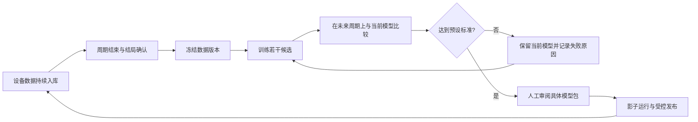

# RSI 在 Booth2 系统里的落地思路

2026-11-20。用户已选择：自动采集、自动训练和评估，人工确认发布。

RSI 严格说是 recursive self-improvement，即系统利用反馈改进自身的改进能力。对当前设备预测系统，先落地一个可验证的持续学习闭环最有价值：让真实结果推动下一版模型，并逐渐自动化实验。大模型可以提出特征、模型或实验建议，但评估规则和发布权限保持独立。

## 一次完整循环

图中“记录失败再训练”是有预算的下一轮实验，不是对同一个测试集无限调参。一次队列用完或没有新增信息，就等待新数据或新的、预先记录的研究假设。

例如，在某周期加工到第 6 小时时，模型估计还剩 5 小时。后来确认该周期在第 8 小时发生电极寿终，那么这一原点的真实剩余加工寿命是 2 小时，这次预测高估了 3 小时。系统将记录这个误差，检查当时可见的波动、斜率、工况和缺测，下一轮尝试降低类似情况的高估。

如果操作员在第 8 小时提前更换了一支仍正常的电极，系统只知道“当时至少还能使用”，并不知道其真实寿终。它应作为删失信息进入生存模型，不能标成恰好剩余 2 小时。同样，模型预测的 5 小时不能回填为真实标签。

## 三层自动化

| 层级 | 系统做什么 | 人负责什么 |
| --- | --- | --- |
| 数据积累 | 持久化、断网缓存、增量同步、去重、质量检查、版本快照 | 确认更换/失效原因、处理异常单位或时间 |
| 模型改进 | 达到新增周期门槛后训练候选，评估误报、漏报、寿命误差、区间与延迟 | 预先确定业务指标、审核具体包并发布 |
| 实验方法改进 | 根据失败周期提出特征/损失/结构改法，在隔离环境跑有限试验 | 审核新训练配方；保持测试集和准入规则独立 |

第一、二层对应成熟的 MLOps 持续训练。第三层才更接近“改进自身的改进方式”：不仅更新参数，还提出新的训练方法。Google 的[持续训练架构](https://docs.cloud.google.com/architecture/mlops-continuous-delivery-and-automation-pipelines-in-machine-learning)强调数据验证、模型评估与版本回滚，这些正是闭环可长期运行的前提。

## 为什么运行越久不一定越准

一分钟 60 条相似采样不会增加 60 个独立失效案例。现在只有 10 个已确认寿终周期，新增不同批次、不同工况和短寿命周期，比重复读取旧数据更有价值。旧数据仍应保留代表性样本，避免新模型只适应最近一种工况。

还存在一种容易忽略的反馈：如果操作员相信预警并提前更换电极，真实寿终以后会越来越少见。此时“后续没有失效”可能是维护成功，不能直接判模型误报。必须同时记录“模型是否报警、人员采取了什么维护动作、为何更换”，并将受干预的结局按删失/竞争风险分析。关于这类反馈循环，可参照 Google 的[机器学习系统技术债研究](https://research.google/pubs/hidden-technical-debt-in-machine-learning-systems/)。

持续改进至少看四组指标：

- 预警是否足够提前、漏掉多少真实事件、每 100 加工小时误报多少次。
- 剩余加工寿命的全程误差和末期高估；不能只看一个平均分。
- 区间是否覆盖真实寿命、是否宽到失去使用价值；未校准区间要明确标识。
- 真实运行的缺测、漂移、推理延迟和可用性。

输入漂移可自动触发调查；它不能单独证明模型精度变差。只有后续真实结局、保持冻结的评估和逐周期对比，才能支持更新。后续工作量/停机安排不确定时，剩余加工小时也不能直接换成“今天几点会坏”。

## 当前代码支持到哪里

`scripts/learning_cycle.py` 已具备独立后台采集、SQLite 一致快照、训练数据准入检查、任务去重与版本记录。建议每 5 秒同步、每天归档、每周检查；初始准入为新增至少 3 个已确认闭合周期且至少 2 个寿终。门槛可根据实际产线周期时长调整，但不能为了让任务频繁启动就把未确认数据当标签。

本轮学校服务器已在隔离容器中完成 v6 研究，模型包与报告已独立核验，见 [v6 评估](model-v6-evaluation.md)。日常自动化仍未接通真实公司历史源，现场通知转为与训练一致的因果特征、标签确认流程也尚未完成；定时模板不会被误报成已经在自动学习。具体部署与状态契约见 [持续采集与训练设计](continuous-learning.md)。

最终用户应看到“正在采集 / 待确认标签 / 候选训练中 / 评估未通过 / 待审核 / 已发布”这些实际状态。所有训练候选都带数据版本、源码版本、指标、输入输出哈希；发布后保留上一版，便于复核和回滚。
