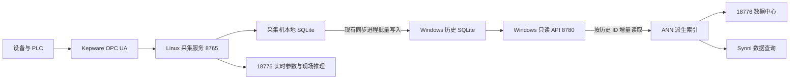

# 现场数据索引与数据中心设计

> 2026-11-20 开发补充：以下现场数值仍是 11-19 的核查快照。候选源码现已有 `history_index.py`、`history_sync.py`、`history_routes.py` 与数据中心页面；新增独立采集、每日一致性快照和候选训练准入工具，详见 [持续采集与训练设计](continuous-learning.md)。开发验证在本机/学校测试服务器进行，尚未验收学校到现场的历史同步，也未安装定时任务。自动化止于候选评估，发布由人确认。

适用范围为 Booth2 Plasma2 和 ANN 现场看板 18776。目标是在 ANN 上提供可续传、可追溯的历史查询和数据质量分析，供数据中心及 Synni 使用。历史库采用 Windows 上现有的 SQLite 服务，ANN 通过已验收的只读 HTTP API 同步增量。高频现场读数和模型推理继续走 Linux 本机采集接口。

## 1. 现场核查结果

核查时间为 **2026 年 11 月 19 日约 03:05（上海时间）**。18776 返回的发布编号是 `site-live28-title-20261119`，现场实时页、门户、训练工作台和 AI 对话的六份页面或静态资源与发布包逐字节一致。实时采集已连接。现场快照的推理状态为未带电，历史索引尚未就绪。

| 对象 | 实际验证 |
| --- | --- |
| Linux 采集接口 `8765` | 已连接，发现和订阅均为 33 个点位，失败订阅为 0。截取时最近 10 秒约为每秒 3.7 条通知，队列和丢弃计数均为 0 |
| Windows 历史 API `8780` | `/api/stats` 返回 128,395 条样本、最新入库 ID 128,395、33 个点位。该数值是一次核查快照 |
| Windows 点位和最新值 | `/api/tags`、`/api/latest` 均返回 33 个点位。最新值有 31 个浮点数、1 个整数和 1 个字符串 |
| 历史分页 | `/api/history` 实测支持省略 `tag`，分页会跨点位按 ID 升序返回。按 `next_after_id` 继续时，后一页 ID 严格大于前一页游标 |
| 点位过滤和时间过滤 | 按 `tag=Current` 分页验证通过。用样本的 `received_at` 同时作为起止时间，查询返回了该样本，符合包含端点的行为 |
| 采集到历史库的对应关系 | 对照了最早可比对的 3 条记录，Linux `seq` 对应 Windows `source_seq`，测点路径、质量、接收时间和值全部一致。另抽查尾部 30 条，来源与序号组合均唯一 |
| 接口调用耗时 | 少量只读请求通过 SSH 转发约为 84–598 ms，供排查连通性参考。容量和性能目标需在现场 ANN 直接调用与实装后测量 |

表中记录逻辑结构和接口实测。Windows SQLite 文件本体的表名、索引、约束、日志模式与执行计划需要按附录从数据服务器复核。同步正确性依赖已实测的 API 游标，索引设计以下文的 ANN 派生数据库为目标。

## 2. 数据链路与职责



- Linux `/api/tags` 提供最新采集状态和每个点位的最后通知。Linux `/api/events?after=...&limit=...` 提供落盘的通知序列，响应使用 `next_after`。
- Windows 接收采集机提交的历史记录。历史 `/api/latest` 的时间取决于同步和入库进度。用它在数据中心展示「最新入库」，用 Linux 接口展示「现场最新通知」。
- ANN 负责本地派生索引和查询。历史查询失败时，实时页继续读取同机采集服务。Synni 还需要其 Ollama 模型就绪，模型服务和数据就绪应分别显示。
- 交接说明中历史读写使用不同权限。ANN 部署只注入只读凭据，使用已有的现场网络白名单。凭据写入服务器权限受限的配置或 Secret，仓库、浏览器、导出和日志均不包含凭据。

## 3. 历史接口与事件语义

历史 API 使用 `X-API-Key`，交接说明还支持 Bearer 头。首版同步优先使用实测通过的 GET 接口。示意请求为 `GET /api/history?after_id=0&limit=1000`，分页上限以交接约定的 5000 为准。

| 字段或接口 | 语义和使用 |
| --- | --- |
| `id` | Windows 历史库的入库游标。用于全局增量读取和确定性分页 |
| `source_id`、`source_seq` | 原始采集来源与通知序号。用于追溯 Linux 事件和幂等校验 |
| `path`、`node_id`、`name` | 完整点位路径是映射依据。保留节点标识和原短名供诊断 |
| `source_timestamp` | OPC UA 源时刻，作为设备时钟证据保留 |
| `server_timestamp` | Kepware 服务时刻 |
| `received_at` | Linux 收到通知的时刻。历史范围查询、统计桶和默认趋势横轴使用它 |
| `ingested_at` | Windows 历史记录入库时刻，用于观察同步延迟 |
| `status` | 原始质量码文本。已见格式包含 `StatusCode(value=0)`，保留原文并增加归一化质量 |
| `value` | JSON 类型。保留原始 JSON，另派生数值列和类型列 |
| `/api/history` | 带 `count`、`events`、`next_after_id`、`has_more`、`order` 的响应。时间筛选按 `received_at`，排序按 `id` |
| `/api/stats` | 总样本数、最大入库 ID、末次接收时刻、点位数及来源进度。来源记录提供 `last_seq` 和 `last_ingested_at` |

系统以 UTC 毫秒整数保存可解析时刻，UI 默认按 `Asia/Shanghai` 显示。原始值和含偏移的时间字符串保存在溯源记录中。延迟和时钟偏差分别展示，保留异常的负延迟以便查时钟。一次接口调用的时间戳可能来自不同机器。数据中心把使用者选择的日历日按上海时区转换为 UTC 半开区间 `[start, end)`，避免跨日重复统计。历史 API 的端点包含规则在客户端做相应去重。

### 点位映射与质量口径

实时页的 28 项模型字段由 `domain/real_contract.py` 定义。现场 33 个点位覆盖 28 项，另 5 项可以在数据中心目录里分类为设备元数据或辅助读数。沿用实时适配器的五条别名。

| 现场短名 | 看板字段 |
| --- | --- |
| `AirJe` | `AirJet` |
| `Cooling_water_inlet_temp`、`Cooling_water_outlet_temp` | 对应看板字段名末尾各有一个句点 |
| `Press_Hopper_1`、`Press_Hopper_2` | `Press._Hopper_1`、`Press._Hopper_2` |

当前现场显示沿用既有单位。登记点位时设置 `unit_confirmed`，并保存映射版本。待现场核对的工程单位和倍率应在派生层显式记录，原值保留可回查。额外点位 `FeedRate`、`Gun_Hours`、`Gun_ID.DATA`、`Gun_ID.LEN`、`Ingitions` 进入目录即可。字符串、计数和设备标识使用各自的表格样式。

- 保留真实零值。质量未知、缺测及无活动通道各自使用明确状态。收到新通知且数值相同也应正常计数。
- 「最后通知已久」描述该点位的更新状态。只有采集状态、全局通知推进或已定义的预期更新规则能支持断线或缺失判定。
- 采集请求周期为 100 ms。OPC UA 通知间隔受数值变化影响，因此统计应区分通知数、时间覆盖和对齐后样本数。尤其须保留 8765 的连通性和单点位更新时间。
- 采集端通知总数、历史库总样本数和 ANN 索引记录数分别取自各层，展示时标明来源、统计时刻和覆盖范围。

## 4. ANN 索引结构

### 4.1 选型与边界

首版使用 ANN 本地 SQLite 作为可重建查询索引，存放于 `state/index` 下独立数据库。该规模和访问方式适合先验证单写者增量入库、按字段和时间范围读取。按实测容量与响应优化后，可把封存时段批次导出为分区 Parquet，复用已有 Arrow 查询能力。

索引中保留原始历史记录和面向展示的聚合。聚合可以重建，且必须有口径版本和处理水位。ANN 派生库可采用 WAL，由专用采集任务写入，API 使用短查询。Windows 源库的日志模式与索引方案按现场核查结果单独管理。[SQLite WAL](https://sqlite.org/wal.html)

### 4.2 DDL 起点

以下是 **ANN 派生库** 的建议 DDL。时间字段单位为 UTC 毫秒。`archive_key` 标识一个历史库的入库 ID 世代，`source_epoch` 标识一个采集端的通知序号世代。历史库重建和采集端重置序列时分别更新对应世代，并记录切换时刻及覆盖范围。

```sql
PRAGMA foreign_keys = ON;

CREATE TABLE tags (
    tag_id INTEGER PRIMARY KEY,
    equipment_key TEXT NOT NULL,
    path TEXT NOT NULL,
    node_id TEXT,
    canonical_key TEXT,
    display_name TEXT NOT NULL,
    unit TEXT,
    unit_confirmed INTEGER NOT NULL DEFAULT 0 CHECK (unit_confirmed IN (0, 1)),
    map_version TEXT NOT NULL,
    UNIQUE (equipment_key, path)
);

CREATE TABLE raw_events (
    archive_key TEXT NOT NULL,
    history_id INTEGER NOT NULL,
    source_id TEXT NOT NULL,
    source_epoch TEXT NOT NULL,
    source_seq INTEGER NOT NULL,
    tag_id INTEGER NOT NULL REFERENCES tags(tag_id),
    received_ms INTEGER NOT NULL,
    source_ms INTEGER,
    server_ms INTEGER,
    ingested_ms INTEGER,
    status_raw TEXT NOT NULL,
    quality TEXT NOT NULL CHECK (quality IN ('good', 'uncertain', 'bad', 'unknown')),
    value_kind TEXT NOT NULL,
    value_json TEXT NOT NULL,
    numeric_value REAL,
    original_json TEXT NOT NULL,
    PRIMARY KEY (archive_key, history_id),
    UNIQUE (source_id, source_epoch, source_seq)
);

CREATE INDEX idx_raw_tag_received
ON raw_events (tag_id, received_ms, archive_key, history_id);

CREATE TABLE ingest_cursor (
    archive_key TEXT PRIMARY KEY,
    committed_history_id INTEGER NOT NULL CHECK (committed_history_id >= 0),
    last_success_ms INTEGER,
    last_source_max_id INTEGER
);

CREATE TABLE history_alias (
    archive_key TEXT NOT NULL,
    history_id INTEGER NOT NULL,
    canonical_archive_key TEXT NOT NULL,
    canonical_history_id INTEGER NOT NULL,
    PRIMARY KEY (archive_key, history_id),
    FOREIGN KEY (canonical_archive_key, canonical_history_id)
        REFERENCES raw_events(archive_key, history_id)
);

CREATE TABLE ingest_issue (
    archive_key TEXT NOT NULL,
    history_id INTEGER NOT NULL,
    reason TEXT NOT NULL,
    detected_ms INTEGER NOT NULL,
    resolved_ms INTEGER,
    PRIMARY KEY (archive_key, history_id)
);

CREATE TABLE metric_bucket (
    tag_id INTEGER NOT NULL REFERENCES tags(tag_id),
    bucket_ms INTEGER NOT NULL,
    window_ms INTEGER NOT NULL,
    rules_version TEXT NOT NULL,
    observed_count INTEGER NOT NULL,
    valid_numeric_count INTEGER NOT NULL,
    low REAL,
    high REAL,
    sum REAL,
    last_value REAL,
    PRIMARY KEY (tag_id, window_ms, rules_version, bucket_ms)
);
```

原始表用主键顺序处理同步和按历史 ID 的导出。时间曲线用点位、时间、历史 ID 的复合索引取连续范围，时间相同的记录按 `(received_ms, archive_key, history_id)` 排序，明细续页使用同一个三字段游标。`history_alias` 保留重导入的溯源关系，趋势和统计只读取 `raw_events`。若后续经常需要跨全部点位按时间浏览，再根据查询计划决定是否补全局时间索引。统计标准差可使用可合并的稳定方差状态。按 `EXPLAIN QUERY PLAN` 验证典型趋势查询在真实规模下走预期索引。[SQLite 查询计划](https://sqlite.org/eqp.html)

### 4.3 增量同步与恢复

1. 启动时读 `/api/stats`，记录本批的上界。首次从 0 启动，后续读取本地已提交的全局历史 ID。增量不传 `tag`，避免遗漏未配置点位。
2. 从 `/api/history?after_id=...` 读页，要求 ID 严格递增。用本地上界截取页面，首次遇到超过上界的记录即结束本轮，下一轮继续读取。ID 可有空洞，连续性以源接口返回的顺序和末页标志校验。
3. 解析时间、质量和 JSON 类型后，在同一事务内更新点位目录、写入原始事件并提交游标。游标取本批实际写入或已确认幂等的末条 ID。需要分段回填时，创建独立任务和水位。
4. 相同入库键重试时核对原始事件。遇到相同采集事件重新导入并分配到不同入库键，比较采集来源、测点、质量、采集时间和原值，确认一致后记录两个入库键的对应关系。遇到内容冲突或解析失败时，记录 ID 和原因并停在失败记录之前，保留人工修复后原位重放的能力。
5. 收到暂时性网络错误时退避重试。收到 `401` 或 `403` 时保持现有索引可读并提示凭据或白名单问题。若来源最大 ID 或来源序号回退，暂停并确认是否为新数据库世代。
6. 聚合按 `received_at` 归桶。对较晚入库的旧通知，找到受影响的桶和天重新聚合，不能依靠单一「最后通知时间」跳过这些数据。
7. 记录每轮入库数量、幂等数、错误数、请求耗时、已提交 ID 和源库最大 ID。运维时检查索引、历史入库和现场采集三个水位。历史断线时继续提供已索引范围，并显示更新延迟。

## 5. 现有数据中心接口迁移

当前 `RealDataStore` 从 `--real-data` 下的仪器 CSV 构建启动索引。它根据文件路径、长度、修改时间和规则生成缓存指纹，产出 manifest、事件表和 Parquet 样本。现有 `frame()` 使用 Arrow 按时间、字段和运行状态读取列。现场目录为空时，索引状态无法进入就绪。

以接口契约为边界新增历史索引读取后端。以产品配置选择历史 API 派生索引或现有 CSV 后端，首次切换先保留核对运行期。逐项保留函数签名和兼容字段，必要处附加 `source_kind`、`freshness`、`observed_count` 等可选字段。采集服务的 `/api/events` 返回原始通知，18776 的 `/api/real/events` 返回派生的数据质量或阈值事件。

| 页面能力 | 现有入口 | 迁移时的合同 |
| --- | --- | --- |
| 数据状态和总览 | `/api/real/status`、`/api/real/overview` | 展示已索引范围、点位数、历史尾部进度、最近成功和错误。保留空、同步中、追平、仅历史可用等状态 |
| 现场趋势与区间统计 | `/api/real/series`、`/api/real/analysis` | 继续支持选择字段、时间和范围。允许带电、活动送料等派生范围时，先使用经验证的对齐方法生成状态，并显示覆盖 |
| 原始明细和导出 | `/api/real/sample`、`/api/real/export` | 显示原始事件 ID、时间、质量和来源，分页和区间明确。导出按时间范围限量、记录查询条件 |
| 数据质量与事件 | `/api/real/data-quality`、`/api/real/events`、`/api/real/anomalies` | 区分原始质量、采集间断、阈值异常。每条派生事件有触发规则版本和证据 |
| 文件和规则 | `/api/real/files`、`/api/real/annotation-rules` | CSV 的物理文件页按数据源适配。数据库模式展示采集来源、索引时段与批次。现场阈值由本地配置和审核启用 |
| Synni 数据工具 | `/api/agent/readiness`、现有 AgentTools | 用同一查询后端和时间口径。就绪检查分别报告 Ollama、可用模型、工具权限与历史索引状态 |

### 初版界面

1. **总览**首屏给出正在查看的设备、时区、已索引范围和历史数据刷新时间。右侧展示现场采集和历史同步状态，可分别进入实时预测或查看历史。
2. **趋势与明细**支持时间范围、点位和数据质量筛选。短范围用原始有效通知，长范围用时间桶最小值、最大值和末值，保留尖峰。两路压力、送料保留各自数据列，空区间在图中断开。表格与趋势共享过滤条件。
3. **数据质量**列出坏质量、久未更新、采集间断、历史同步落后和有争议的单位。点击一条可跳到同一时间范围。分开展示数据质量告警和模型风险预警。
4. **采集来源与导出**提供点位字典和映射记录。历史来源采用「采集来源」「索引时段」「批次」组织。导出附带时区、字段、单位、质量口径、更新时间与筛选条件。

接口原始数据是异步长表。多点位同秒对齐、带电和通道状态应放到带版本的派生层。对齐时只允许使用该时刻以前且未超过有效期的读数，保留观测掩码。持有值可用于显示已知最近状态，统计和训练输入按各自口径决定是否纳入。相同点位多次通知须保留原始事件，绘图才允许按秒合并。

## 6. 开发任务及验收顺序

| 阶段 | 任务 | 验收 |
| --- | --- | --- |
| 1. 数据同步 | 实现只读历史客户端、点位解析、ANN SQLite 增量写入和状态接口 | 分页必须继续推进；重复提交、崩溃后重启保持同一水位和记录数；断网时实时页继续工作 |
| 2. 历史查询 | 接入趋势、总览、点位目录、原始明细和支持时间范围的导出 | 把两个点位的一个有界时段逐条与源 API 对拍；完整覆盖 UTC 到本地日期、相同毫秒、零值、字符串和坏质量 |
| 3. 派生统计 | 明确带电、活动通道、通知间隔、晚入库聚合与规则版本 | 用停机、运行、断线重连和冻结样本分别复核；不同时间区间拼接无重叠或遗漏 |
| 4. 数据中心页面 | 替换空索引首页；加入真实历史范围、质量、数据来源和导出 | 在现场窗口实测中英文、深浅主题、桌面窄高；API 暂停时保留可查询历史并标注新鲜度 |
| 5. Synni | 连接授权的 Ollama，使用同一历史查询后端 | UI 可区分模型离线、数据未就绪和两者均可用；回答可追溯到查询区间、点位和索引水位 |

初始性能验收建议在现场 ANN 做分层测量。记录当前数据量和至少十倍的合成规模、写入并发、冷启动和缓存场景。典型目标为最近一小时多点位趋势 p95 小于 1 秒，七天降采样趋势 p95 小于 2 秒，连续同步时水位落后小于 30 秒。先确认实际读写速率再确定正式阈值和归档策略。

## 7. 现场只读复核清单

- Windows 物理 SQLite 的 DDL、主键、唯一约束、复合索引、日志模式和实际查询计划。
- 采集序号在采集应用重启、SQLite 重建或主备切换后的行为，并验证来源世代交接流程。
- 三台设备的时间同步来源、原始时区、工程单位及准确倍率。重点核对 `AirJe`、两个料斗压力、功率在喷涂时是否持续产生可用观察。
- Windows 历史 API 的只读白名单、限速、同步背压和大范围查询保护。对 401、403、超时、分页上限和断点重试分别验收。
- 从真实生产时段抽查产品起止、活动通道、零值、质量和告警。实时推理与数据中心各自保留样本准备和验收证据。

### 附录　读取 Windows SQLite 结构

在经现场授权的 Windows 数据服务器上打开 PowerShell。文件路径以实际服务配置为准。命令使用只读 URI 并只输出表、索引和日志模式。若文件无法以只读方式打开，请使用运维提供的一致性快照复核，保持生产库现有参数。

```powershell
@'
import pathlib, sqlite3
p = pathlib.Path(r'C:\KepwareDataServer\data\plasma2_history.sqlite3')
with sqlite3.connect(p.as_uri() + '?mode=ro', uri=True) as db:
    print('journal_mode:', db.execute('PRAGMA journal_mode').fetchone()[0])
    for kind, name, ddl in db.execute("""
        SELECT type, name, sql FROM sqlite_master
        WHERE type IN ('table', 'index') AND sql IS NOT NULL
          AND name NOT LIKE 'sqlite_%'
        ORDER BY type, name
    """):
        print(kind, name, ddl)
'@ | python -
```

用 `PRAGMA index_list`、`PRAGMA index_xinfo` 检查包含自动索引的列顺序。用实际表名复核已验证的两类 SQL，分别是按入库 ID 续页，以及指定点位和接收时间范围的查询。生产库的索引变更由现场运维单独验收。[SQLite PRAGMA](https://sqlite.org/pragma.html#index_list)
